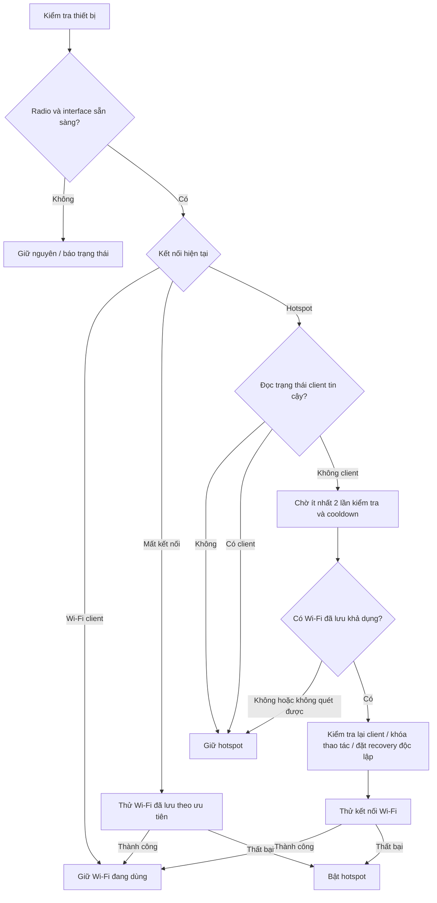

# Plan: Raspberry Pi 4 dashboard V2

Ngày khảo sát: 12/10/2026. Phạm vi hiện tại: kế hoạch thiết kế và khảo sát hệ thống; chưa đổi giao diện production hoặc cấu hình mạng.

## Hướng thiết kế đã chọn

Dựa trên ba ảnh tham chiếu của người dùng: card trắng bo tròn trên nền xanh xám rất nhạt, tiêu đề sans-serif đậm, nhãn xanh xám, giá trị tối màu, nút viền xanh và điểm nhấn đỏ hồng cho hotspot. Không tiếp tục phong cách serif/nền xanh lá của bản hiện tại.

- Title trình duyệt: `Raspberry Pi 4 — Bảng điều khiển`.
- Header: logo Raspberry Pi chính thức, tên thiết bị `Raspberry Pi 4`, hostname phụ và trạng thái cập nhật. Bỏ toàn bộ nhãn `rasp/`, kể cả login, trang chuyển mạng và footer.
- Dùng asset logo từ nguồn Raspberry Pi, giữ tỷ lệ và màu gốc; lưu trong static assets để hoạt động offline. Nhận diện thiết bị trong dashboard nội bộ, không tạo biểu tượng bằng emoji hay vẽ lại logo.
- Card radius khoảng 22px, padding 24px, border mảnh, bóng nhẹ; body 15–16px, tiêu đề 20–24px, nhãn đủ tương phản. Trạng thái có cả chữ và màu.
- Desktop: hàng chỉ số hệ thống, sau đó ba card mạng: Kết nối hiện tại / Quét mạng Wi-Fi / Fallback Hotspot. Bên dưới là mạng đã lưu, thêm Wi-Fi, ổ đĩa và dịch vụ.
- Tablet: hai cột; mobile: một cột, không cắt SSID dài hoặc các giá trị DNS. Không ép card cùng chiều cao trên màn hình nhỏ.

## Thành phần và hành vi

| Thành phần | Nội dung và tương tác |
|---|---|
| Hệ thống | Nhiệt độ, CPU, RAM, swap, uptime, load; vẫn cập nhật mỗi 5 giây và dừng polling khi tab ẩn |
| Kết nối hiện tại | Trạng thái, SSID, IP, gateway, toàn bộ DNS, tín hiệu phần trăm; bố cục nhãn trái/giá trị phải như ảnh 3 |
| Quét mạng Wi-Fi | Tiêu đề và nút Quét như ảnh 2; danh sách có chiều cao giới hạn/cuộn riêng, SSID, bảo mật, icon cột sóng và %, nút Chọn điền SSID vào form |
| Fallback Hotspot | Card như ảnh 1; SSID, loại bảo mật, địa chỉ IP, ưu tiên, mật khẩu `••••••••`, trạng thái guard và nút Chuyển sang Hotspot |
| Trạng thái hotspot | Tách rõ `Sẵn sàng`, `Đang phát`, `Chưa cấu hình`, `Guard lỗi`; profile bật autoconnect không có nghĩa AP đang phát hoặc đã kiểm chứng toàn bộ flow |
| Mạng đã lưu | Đánh dấu mạng đang dùng, sửa ưu tiên, kết nối và xóa có xác nhận; bảo vệ fallback và profile đang active |
| Phản hồi tác vụ | Đang quét, không có mạng, lỗi driver/AP scan, mất kết nối, dữ liệu cũ; không hiện thông báo thành công trước khi thao tác thực sự hoàn tất |

Mật khẩu hotspot chỉ hiển thị mặt nạ cố định. Không đọc/chuyển mật khẩu thật vào HTML, thuộc tính DOM, API dashboard hoặc log chỉ để che bằng CSS/input password. Phân biệt mật khẩu hotspot với tài khoản Web và mật khẩu SSH. Hiện/chỉnh mật khẩu thật nằm ngoài phạm vi plan này.

Không hardcode IP/SSID/priority/bảo mật từ ảnh; đọc các trường công khai từ profile NetworkManager thực tế. Bổ sung timestamp/state/error của guard, lần kiểm tra gần nhất và client count khi có dữ liệu tin cậy. API status hiện chỉ trả DNS đầu tiên; cần trả danh sách DNS cho card mới.

## UTF-8 và font tiếng Việt

Khảo sát live: template/helper/guard decode UTF-8 nghiêm ngặt thành công; NFC; không BOM và không ký tự U+FFFD. HTTP login trả `text/html; charset=utf-8`. SHA256 khớp source local. Không có bằng chứng lỗi encoding đang xảy ra; cần cải thiện typography và bảo đảm chuỗi dữ liệu xuyên suốt.

1. Source UTF-8 không BOM, nội dung UI tiếng Việt NFC; HTML `lang=vi`, meta charset UTF-8 và response charset UTF-8.
2. Bundle Noto Sans đầy đủ glyph tiếng Việt bằng WOFF2 cục bộ, weight thật 400/500/600/700; kèm license font. Không chỉ lấy subset latin, không phụ thuộc Google Fonts/CDN khi mất Internet.
3. Dùng line-height đủ cao cho dấu, tránh chiều cao cố định cắt chữ, không dùng icon-font cho trạng thái. SVG cho icon mạng/tài nguyên; giá trị số dùng tabular numerals trong font hỗ trợ.
4. CSS/JS tách khỏi template thành static files dễ bảo trì. Installer và payload allowlist phải bổ sung các asset mới; rollback phải bao phủ static directory.
5. Kiểm tra glyph với `Nhiệt độ`, `Địa chỉ IP`, `Ưu tiên`, `Đang kết nối`, `Bộ nhớ`, `Ổ đĩa`, `Khôi phục`, `Ắ ằ ễ ộ ự Đ đ`; font load thành công và ảnh trên desktop/mobile, cả khi ngắt Internet.
6. Không normalize/trim password Wi-Fi. Đối với SSID, giữ nguyên giá trị thực từ NetworkManager, escape qua Jinja/textContent; kiểm tra giới hạn byte SSID thay vì giả định số ký tự luôn bằng số byte.

## Kết quả kiểm tra fallback hiện tại

- Web và `piwifi-guard.timer` active. Journal ghi các pass thành công và giữ mạng `netplan-wlan0-Hoang Phuc 5G`; Wi-Fi state 100, IP 192.168.1.30/24.
- Profile `Pi-Fallback`: mode AP, SSID RaspPI4OfTT, WPA-PSK, shared IPv4 192.168.50.1/24, autoconnect yes, priority -50.
- Guard hiện giữ mọi profile đang active, kể cả AP. Khi radio bật và thiết bị disconnected, thử Wi-Fi autoconnect theo priority trong budget, sau đó bật fallback.
- Chưa có nhánh tự quay từ hotspot về Wi-Fi. Do đó chưa đáp ứng lựa chọn mới của người dùng.
- Recovery hiện chạy độc lập sau 90s nhưng chỉ kiểm tra expected profile và IPv4. Chưa xác nhận DHCP/gateway/đường quản trị đầy đủ, chưa kiểm thử mất mạng vật lý.
- Chưa có khóa chung giữa guard và thao tác từ dashboard; cần kiểm soát cạnh tranh và trạng thái chuyển mạng trước khi thêm auto-return.
- Live chưa cài `iw`; driver WLAN là `brcmfmac`. Cần bổ sung công cụ đọc station và kiểm tra khả năng scan AP trên chính driver này; không suy luận zero-client chỉ vì công cụ không tồn tại.
- Kiểm tra live chỉ chứng minh scheduler/profile và nhánh giữ Wi-Fi; không chứng minh boot không router, xác thực Wi-Fi sai hoặc duy trì client AP trên phần cứng.

## Flow mục tiêu theo lựa chọn người dùng

Yêu cầu triển khai:

- Nhận diện client theo station association của AP, hỗ trợ thêm phiên quản trị TCP; không chỉ dựa vào ARP hoặc DHCP lease cũ. Cài/kiểm tra công cụ và khả năng driver cần thiết. Nếu thiếu quyền/công cụ hoặc kết quả không chắc chắn, giữ hotspot.
- Không quét/tắt AP để dò Wi-Fi khi còn client. Khi không có client, chỉ dò bằng cách driver hỗ trợ; scan lỗi/không hỗ trợ thì giữ AP.
- Chống flapping: hai lần không có client liên tiếp, cooldown và backoff khi mật khẩu/connection lỗi. Kiểm tra client lần nữa ngay trước chuyển; nếu xuất hiện client thì hủy chuyển.
- Dùng UUID profile, khóa chung cho các thay đổi mạng, skip khi NetworkManager đang connecting hoặc có thao tác người dùng. Manual hotspot cần khoảng giữ tối thiểu, tránh tự chuyển ngay trước khi người dùng kịp kết nối.
- Recovery phải được đặt thành công trước khi đổi mạng và chạy độc lập trên Pi. Kiểm tra kết nối cục bộ và khả năng quản trị; không dùng một website Internet làm điều kiện duy nhất, vì mạng có thể hợp lệ nhưng không có Internet.
- Định nghĩa rõ: router mất Wi-Fi khác với router vẫn kết nối nhưng mất Internet. Trường hợp sau không tự bật hotspot chỉ vì một probe Internet thất bại.

## Trình tự thực hiện

1. Thêm API metadata hotspot và guard; củng cố trạng thái/recovery/khóa mạng. Không lấy mật khẩu plaintext cho dashboard.
2. Viết lại template, tách CSS/JS, bundle font/logo. Preview theo ba ảnh tham chiếu; kiểm tra login, chuyển mạng, trạng thái rỗng/lỗi và màn hình nhỏ.
3. Bổ sung auto-return và các test hành vi: client AP giữ nguyên; không đọc được client giữ nguyên; zero-client/cooldown mới được thử; Wi-Fi lỗi quay lại AP; cạnh tranh thao tác; radio disabled; SSID Unicode.
4. Deploy có snapshot và xác minh authenticated HTTP/API, UTF-8, font/static assets, timer, status. Dọn asset cũ theo inventory; giữ snapshot trước release và tránh thêm database/agent giám sát không cần thiết.
5. Kiểm tra flow thật theo từng tình huống với watchdog độc lập: chuyển AP rồi quay về, Wi-Fi sai mật khẩu, không có Wi-Fi đã lưu, client AP đang dùng và router xuất hiện lại. Boot/outage tests cần recovery được kiểm chứng trước khi ngắt đường SSH duy nhất.

## Tiêu chí hoàn thành

- Không còn `rasp/`; title/logo thống nhất ở mọi trang.
- Các card theo ba ảnh; IP/gateway/DNS và fallback metadata là dữ liệu thật, không hardcode.
- Không lỗi ký tự hoặc mất glyph tiếng Việt; font/logo tải offline; không tràn layout ở 390px.
- Password hotspot được che và không xuất hiện dạng plaintext trong response/log.
- API mới vẫn yêu cầu login, POST thay đổi có CSRF; không phát sinh shell endpoint tùy ý.
- Auto-return đúng lựa chọn: có client giữ AP; không client và Wi-Fi khả dụng mới chuyển; thất bại khôi phục AP. Những flow chưa thử trên phần cứng phải được nêu rõ trong báo cáo.

## Nguồn asset

- Logo chính thức: https://www.raspberrypi.com/app/uploads/2022/02/COLOUR-Raspberry-Pi-Symbol-Registered.png
- Nguồn/guideline: https://www.raspberrypi.com/trademark-rules/
- Font có subset Vietnamese: https://github.com/google/fonts/blob/main/ofl/notosans/METADATA.pb

Ba ảnh do người dùng cung cấp là tham chiếu bố cục/style; không lấy thông số trong ảnh thay cho cấu hình live.
